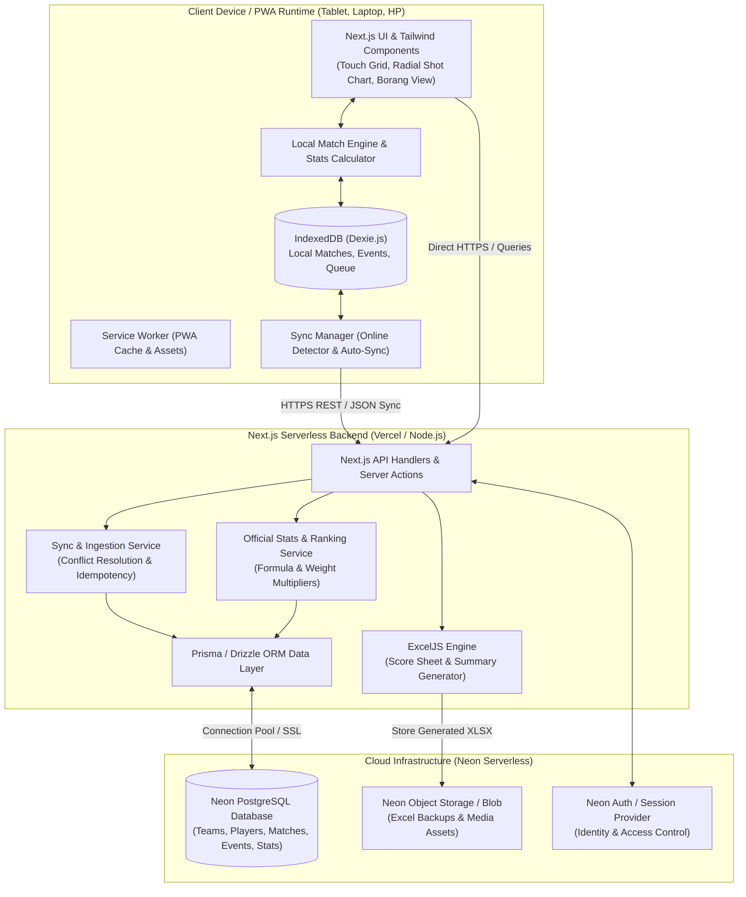
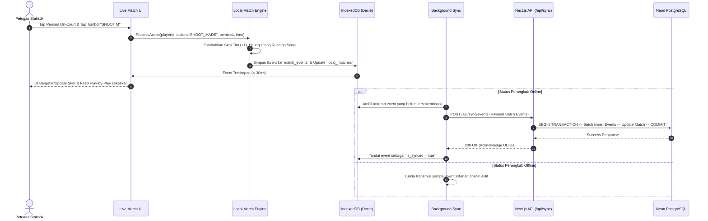
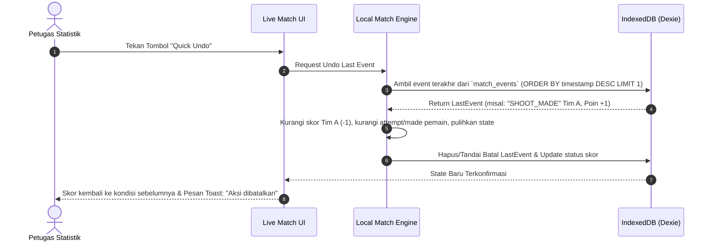
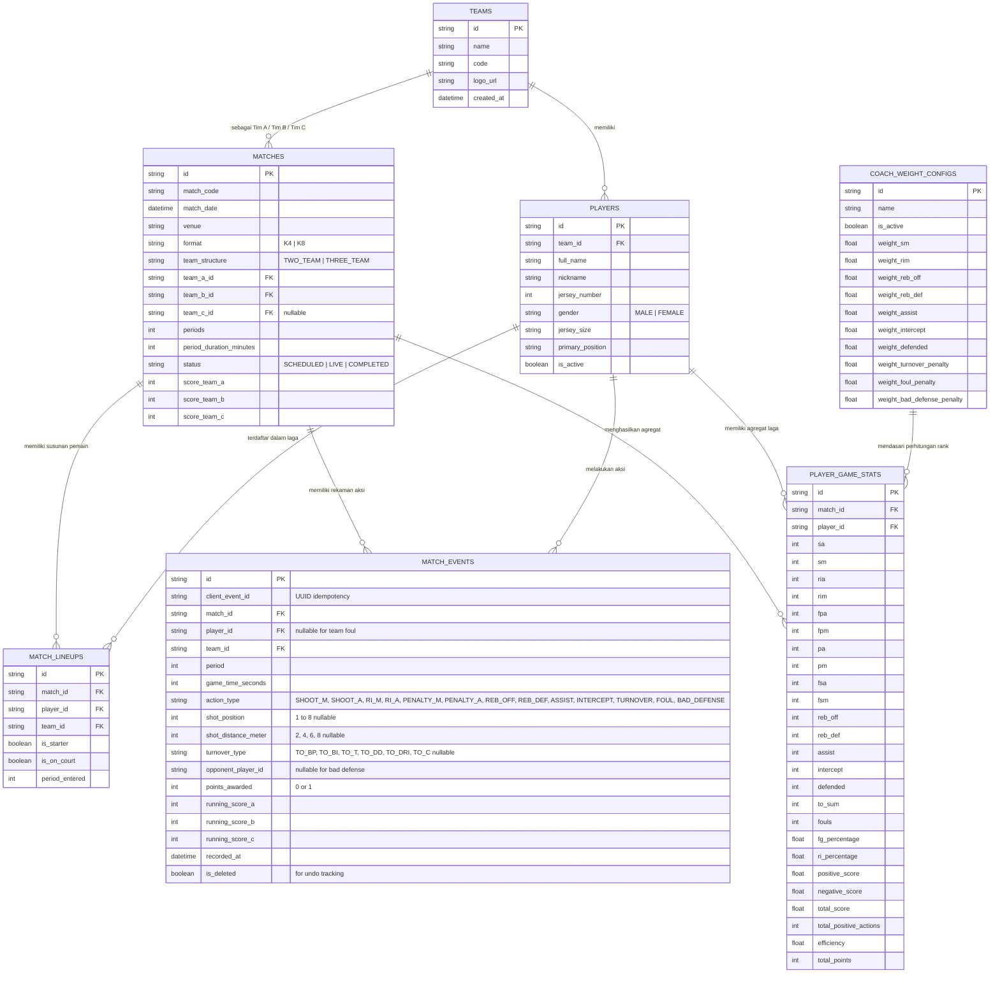

# SYSTEM ARCHITECTURE DOCUMENT (ARCHITECTURE.md)
## KorfStats Bantul — Desain Arsitektur Sistem & Spesifikasi Teknis

| Metadata Dokumen | Nilai |
|---|---|
| **Versi** | 1.0 |
| **Tanggal Terbit** | 2026-10-10 |
| **Pola Arsitektur** | Modular Monolith / Offline-First PWA / Event-Sourced Match Logging |
| **Arsitek / Penulis** | Principal Software Architect & Tim Engineering KorfStats Bantul |
| **Status Dokumen** | Approved |

---

## 1. Gambaran Umum Arsitektur (High-Level Architecture)

### 1.1 Deskripsi Gaya Arsitektur
Sistem **KorfStats Bantul** dibangun menggunakan arsitektur **Modular Web Application** berbasis **Next.js (App Router)** dengan kapabilitas **Offline-First Progressive Web App (PWA)**. 

Pola arsitektur ini dipilih berdasarkan tantangan lapangan nyata di mana konektivitas internet di gelanggang olahraga (GOR) sering tidak stabil. Sistem menerapkan prinsip:
1. **Local-First Event Capture**: Setiap aksi pertandingan (*shot, foul, rebound, assist, turnover*) pertama kali dicatat secara instan ke dalam penyimpanan lokal browser (**IndexedDB via Dexie.js**). Ini menjamin latensi interaksi $< 50\text{ ms}$ dan memastikan data tidak pernah hilang saat koneksi terputus.
2. **Event-Sourced Match Logging**: Setiap peristiwa dalam laga diperlakukan sebagai immutable event record berurutan (*append-only log*). Pendekatan ini memungkinkan fitur **Quick Undo**, pemutaran ulang linimasa (*play-by-play*), serta kalkulasi ulang statistik yang 100% akurat.
3. **Background Cloud Synchronization**: Modul sinkronisasi di latar belakang (*background sync queue*) secara otomatis mengirimkan rekaman pertandingan yang belum tersinkronisasi ke basis data **Neon PostgreSQL** begitu perangkat mendeteksi jaringan internet aktif.
4. **Symmetric Calculation Engine**: Formula evaluasi performa dijalankan secara simetris di sisi client (untuk pratinjau real-time) dan diverifikasi di sisi server (untuk keabsahan arsip dan perangkingan resmi).
5. **High-Fidelity Document Generation**: Menggunakan **ExcelJS** untuk mereplikasi struktur grid, border, font, dan format sel lembar cetak borang fisik `PRINT SCORE SHEET.xlsx` serta rekapitulasi `STATISTIK GAME BANTUL.xlsx`.

### 1.2 Diagram Arsitektur Tingkat Tinggi (Mermaid Container Diagram)



---

## 2. Katalog Komponen & Tanggung Jawab Layanan

### 2.1 Presentation & PWA Client Layer
| Aspek | Spesifikasi & Keterangan |
|---|---|
| **Teknologi** | Next.js 14+ (React 18), Tailwind CSS, Lucide React, Recharts |
| **Penyimpanan Lokal** | IndexedDB dikelola oleh **Dexie.js** dengan schema terindeks |
| **Kapabilitas PWA** | Service Worker untuk offline shell caching, Web App Manifest (bisa di-install di Android, iOS, Windows, macOS) |
| **Tanggung Jawab Utama** | - Merender antarmuka live recording dengan touch latency ultra-rendah.<br>- Menyediakan pemilih spot radial tembakan 360° interaktif (SVG).<br>- Menjalankan timer pertandingan lokal independen dari koneksi server.<br>- Menyimpan antrean transaksi offline (*offline mutations queue*). |

### 2.2 Local & Server Match Engine (Dual-Core Symmetry)
| Aspek | Spesifikasi & Keterangan |
|---|---|
| **Teknologi** | TypeScript Shared Utility (`/src/lib/korf-engine/`) |
| **Tanggung Jawab Utama** | - Memproses event aksi: tembakan (Made/Attempt), foul, turnover, assist, rebound, intercept.<br>- Memperbarui running score tim secara real-time.<br>- Menangani operasi **Quick Undo** (membalikkan mutasi skor dan mengembalikan keadaan sebelumnya).<br>- Menghitung metrik performa: FG%, RI%, FP%, P%, FS%, Positive, Negative, Total Score, Efisiensi. |

### 2.3 Cloud Synchronization Service
| Aspek | Spesifikasi & Keterangan |
|---|---|
| **Teknologi** | RESTful JSON API (`/api/sync`) + Next.js Server Actions |
| **Protokol Sinkronisasi** | Batch upsert berdasar UUID lokal (`clientEventId`). Menerapkan sifat *idempotent* sehingga transmisi ulang yang berulang tidak menduplikasi data. |
| **Resolusi Konflik** | Last-Write-Wins (LWW) dengan event sequence numbering; append-only untuk tabel `match_events`. |

### 2.4 Excel & Document Reporting Service
| Aspek | Spesifikasi & Keterangan |
|---|---|
| **Teknologi** | **ExcelJS** (Node.js runtime) |
| **Tanggung Jawab Utama** | - Membaca template dan merender file Excel persis tata letak `PRINT SCORE SHEET.xlsx` (Sheet 2 Team dan Sheet 3 Team).<br>- Merender file Excel rekapitulasi analitik komprehensif `STATISTIK GAME BANTUL.xlsx`.<br>- Memparsing file Excel yang diunggah pengguna untuk memasukkan data pemain atau riwayat pertandingan lama. |

### 2.5 Cloud Database & Storage (Neon)
| Aspek | Spesifikasi & Keterangan |
|---|---|
| **Teknologi** | **Neon Serverless PostgreSQL** + Prisma ORM |
| **Konektivitas** | Neon Connection Pooling (`pgbouncer`) via URL berformat `postgres://...` dengan SSL aktif. |
| **Object Storage** | Penyimpanan file spreadsheet ekspor, template borang, dan backup data arsip. |

---

## 3. Diagram Alur Transaksi & Interaksi Kritis (Sequence Flows)

### 3.1 Alur Pencatatan Live Match (Offline-First to Cloud Sync)



### 3.2 Alur Operasi Quick Undo (Koreksi Salah Tap)



### 3.3 Alur Ekspor Score Sheet ke Format Excel Fisik

```mermaid
sequenceDiagram
    autonumber
    actor User as Pelatih / Ofisial
    participant UI as Dashboard Laporan
    participant API as Next.js API (/api/matches/{id}/export-scoresheet)
    participant DB as Neon PostgreSQL
    participant ExcelGen as ExcelJS Generator

    User->>UI: Klik "Download Score Sheet (.xlsx / PDF)"
    UI->>API: GET /api/matches/{id}/export-scoresheet?format=xlsx
    API->>DB: Query Match, Roster Tim, Lineups, & Running Score Events
    DB-->>API: Match Complete Data
    API->>ExcelGen: BuildScoreSheetWorkbook(matchData, templateType="2_TEAM")
    ExcelGen->>ExcelGen: Terapkan Styling: Font, Border, Cell Merge, Header Korfball Bantul, Running Score Table
    ExcelGen-->>API: Buffer Binary XLSX Stream
    API-->>UI: HTTP 200 (Content-Disposition: attachment; filename="SCORE_SHEET_MATCH_01.xlsx")
    UI-->>User: Berkas terunduh siap cetak di kertas A4
```

---

## 4. Skema Basis Data Relasional (ERD & Data Dictionary)

### 4.1 Entity Relationship Diagram (Mermaid ERD)



---

## 5. Keputusan Arsitektur Kritis (Architectural Decision Records - ADR)

### ADR-01: Pemilihan PWA Offline-First dengan Dexie.js (IndexedDB) + Neon PostgreSQL
- **Konteks**: Pertandingan Korfball sering diselenggarakan di GOR tertutup dengan penetrasi sinyal seluler yang buruk. Aplikasi tidak boleh macet atau kehilangan data saat sinyal terputus di tengah laga.
- **Keputusan**: Menggunakan arsitektur PWA Local-First. Frontend menulis setiap event ke IndexedDB browser terlebih dahulu menggunakan **Dexie.js**, kemudian Service Worker menyinkronkan event ke cloud backend **Neon PostgreSQL** via background fetch.
- **Konsekuensi Positif**: Latensi input di pinggir lapangan $< 30\text{ ms}$; aplikasi tetap responsif 100% tanpa sinyal internet; data tersimpan aman di perangkat lokal sebelum terunggah.
- **Mitigasi Risiko**: Menggunakan UUID yang di-generate di browser (`client_event_id`) untuk menjamin idempoten saat pengiriman ulang (*retry sync*).

### ADR-02: Event-Driven Log Architecture untuk Pencatatan Pertandingan
- **Konteks**: Sistem membutuhkan fitur **Quick Undo**, audit riwayat kesalahan pencatatan, linimasa play-by-play, serta kalkulasi running score yang transparan.
- **Keputusan**: Semua kejadian pertandingan disimpan sebagai baris terpisah dalam tabel `match_events` (pola event log terurut). Skor dan statistik agregat adalah proyeksi turunan (*derived projections*) dari rangkaian event log tersebut.
- **Konsekuensi Positif**: Tombol Quick Undo dapat membalikkan aksi terakhir secara atomik tanpa merusak konsistensi tabel lain; timeline pertandingan dapat direkonstruksi ulang kapan saja.

### ADR-03: Penggunaan ExcelJS untuk High-Fidelity Spreadsheet Template Replication
- **Konteks**: Tim Korfball Bantul memiliki kebiasaan mencetak borang fisik `PRINT SCORE SHEET.xlsx` dan mereview arsip `STATISTIK GAME BANTUL.xlsx`. Format ekspor harus memiliki batas sel, warna sel kuning running score, dan tata letak yang identik dengan file aslinya.
- **Keputusan**: Menggunakan pustaka **ExcelJS** di lingkungan Node.js server.
- **Konsekuensi Positif**: Kontrol penuh terhadap styling sel, merge range, border ganda, orientasi cetak landscape, dan formula Excel bawaan.

### ADR-04: Kalkulasi Statistik Server-Side & Local Engine yang Simetris
- **Konteks**: Formula perhitungan di Excel Bantul melibatkan banyak pembagian (persentase) dan penjumlahan gabungan. Perhitungan harus tampil instan di layar tablet sekaligus terverifikasi absah di database server.
- **Keputusan**: Membuat pustaka utilitas tunggal TypeScript (`korf-calculator.ts`) yang dapat diimpor langsung oleh client React maupun server Next.js.
- **Konsekuensi Positif**: Tidak ada duplikasi kode logika bisnis; hasil perhitungan di layar lapangan selalu sama persis dengan laporan resmi di server.

---

## 6. Desain Antarmuka Pengguna & Komponen Visual

### 6.1 Layout Layar Pencatatan Live Match (Dashboard Terpadu)
Layar dioptimalkan untuk orientasi landscape tablet dan desktop:
- **Header Atas (Sticky)**: 
  - Match Code, Nama Tim A vs Tim B, Indikator Babak (Period 1 / 2), Digital Stopwatch (Play / Pause / +1m / -1m), dan Indikator Status Koneksi (Hijau: Online / Kuning: Offline / Biru: Syncing).
- **Kolom Kiri (On-Court Lineup & Quick Action Pad)**:
  - Kartu Pemain Aktif: 4 kartu pemain (K4) atau 8 kartu pemain (K8) dengan foto, nomor punggung, nama, dan gender.
  - Tombol Aksi Utama: Tombol tap besar berkode warna kontras:
    - *Hijau Muda*: Shoot Made (+1 pt), Running In Made (+1 pt), Penalty/FS Made (+1 pt).
    - *Abu-abu / Netral*: Shoot Attempt, Running In Attempt, Penalty/FS Attempt.
    - *Biru*: Offensive Rebound, Defensive Rebound, Assist, Intercept.
    - *Kuning / Merah*: Turnover (pop-up tipe), Foul, Bad Defense.
- **Kolom Kanan (Play-by-Play Feed & Running Score)**:
  - Linimasa real-time: menampilkan waktu, nama pemain, tipe event, dan penambahan skor.
  - Tombol **Quick Undo** (merah tegas di bagian atas feed).
  - Tab Switcher: Beralih antara tampilan **Feed Play-by-Play** dan **Borang Matrix View** (replika lembar skor fisik).

### 6.2 Diagram Pemilih Spot Tembakan 360° (Radial SVG Selector)
- Lingkaran konsentris berpusat pada tiang Korf (Post):
  - Ring 1: Jarak 2 Meter
  - Ring 2: Jarak 4 Meter
  - Ring 3: Jarak 6 Meter
  - Ring 4: Jarak 8 Meter
- Dibagi ke dalam 8 sektor sudut (Posisi 1 sampai Posisi 8):
  - Setiap irisan dapat di-tap langsung dengan sentuhan jari.
  - Pada halaman analitik, diagram yang sama berfungsi sebagai **Heatmap** yang menampilkan persentase keberhasilan tembakan (hijau untuk persentase tinggi, merah untuk rendah).

---

## 7. Rencana Integrasi & Topologi Infrastruktur

```
┌──────────────────────────────────────────────────────────────┐
│                    Pengguna Lapangan (PWA)                   │
│   (Tablet / Smartphone / Laptop di GOR tanpa/dengan internet)│
└──────────────────────────────┬───────────────────────────────┘
                               │ HTTPS (Vercel Edge Network)
                               ▼
┌──────────────────────────────────────────────────────────────┐
│               Hosting Aplikasi (Vercel / Node.js)            │
│   - Next.js Web App Shell & SSR                              │
│   - Serverless API Routes (/api/sync, /api/reports, dll.)    │
│   - ExcelJS Spreadsheet Worker                               │
└──────────────────────────────┬───────────────────────────────┘
                               │ SSL Encrypted TCP (Port 5432)
                               ▼
┌──────────────────────────────────────────────────────────────┐
│           Neon Serverless Cloud Infrastructure               │
│   - PostgreSQL Database Engine (Auto-scaling, Pooling)       │
│   - Neon Object Storage (Bucket untuk file ekspor & backup)  │
│   - Neon Auth Service (Otentikasi & Keamanan)                │
└──────────────────────────────────────────────────────────────┘
```

---

## 8. Panduan Konfigurasi Lingkungan (`.env`)

```ini
# Database Connection (Neon Serverless PostgreSQL)
DATABASE_URL="postgres://[user]:[password]@[neon-hostname]/[database]?sslmode=require"
DIRECT_URL="postgres://[user]:[password]@[neon-hostname]/[database]?sslmode=require"

# Application Settings
NEXT_PUBLIC_APP_NAME="KorfStats Bantul"
NEXT_PUBLIC_APP_VERSION="1.0.0"

# Storage & Auth
NEON_STORAGE_ENDPOINT="https://storage.neon.tech"
NEON_STORAGE_ACCESS_KEY="[storage-access-key]"
NEON_STORAGE_SECRET_KEY="[storage-secret-key]"
AUTH_SECRET="[random-32-chars-jwt-secret]"
```
