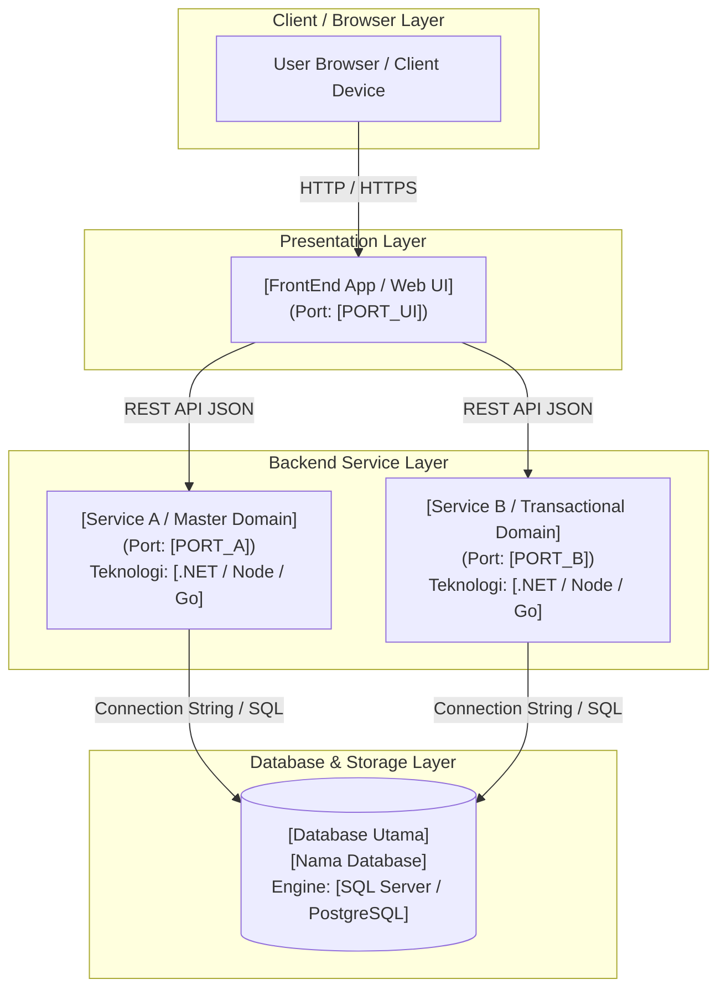
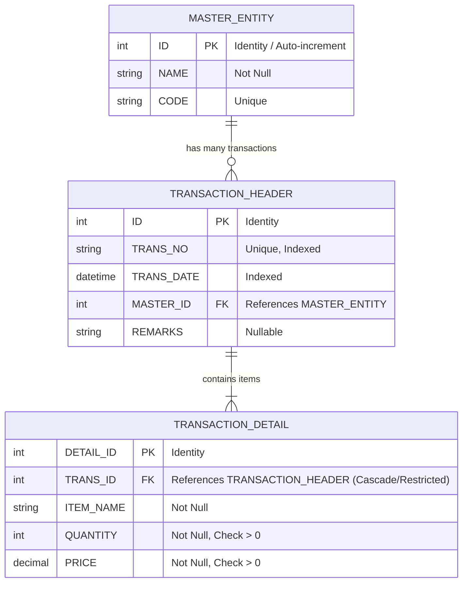
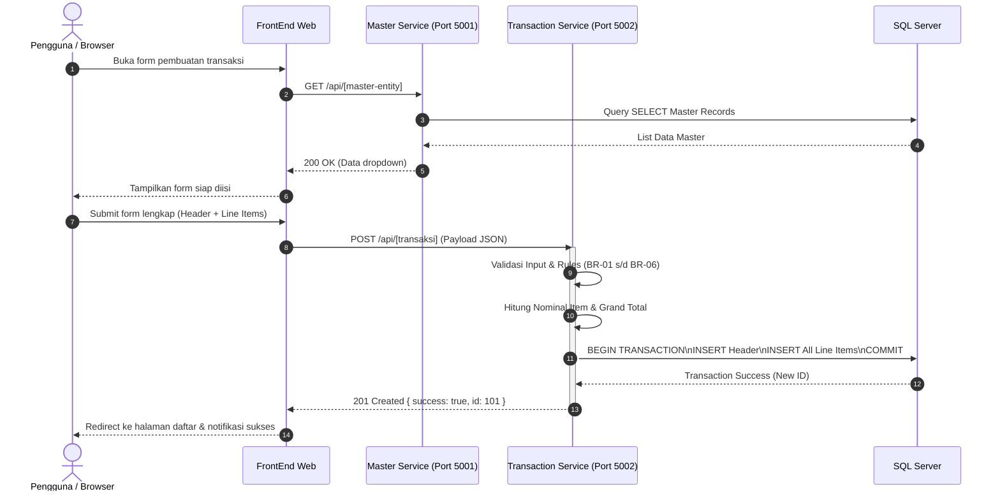
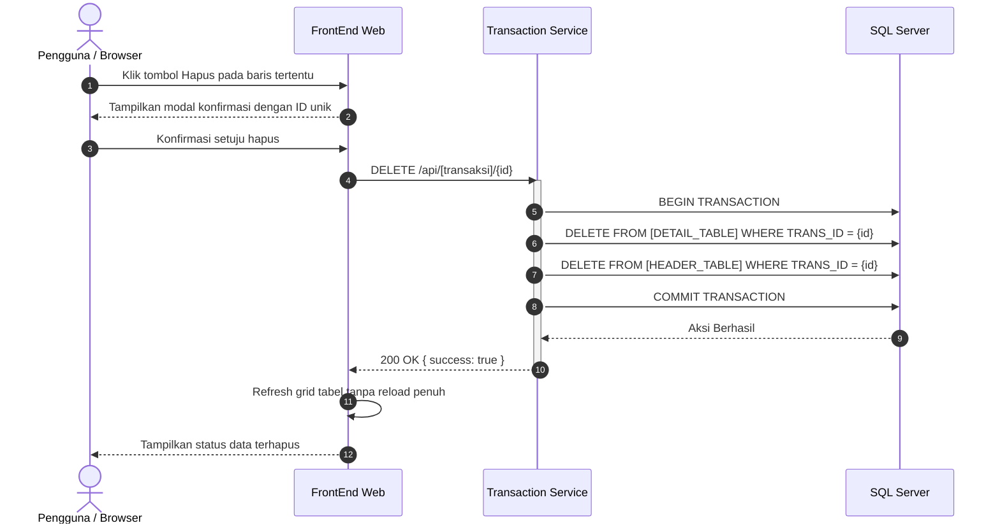
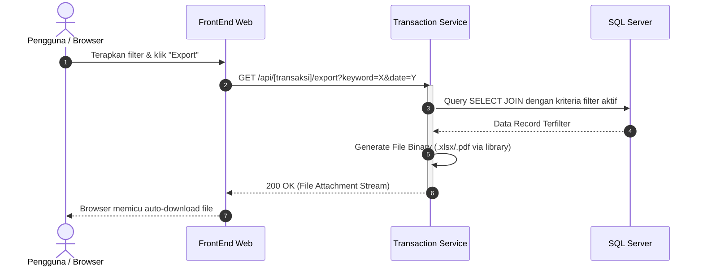

# TEMPLATE: SYSTEM ARCHITECTURE DOCUMENT (ARCHITECTURE.md)
<!-- 
================================================================================
🤖 INSTRUKSI UNTUK AI AGENT (PANDUAN OPERASIONAL):
1. MODE PEMBUATAN DOKUMEN (GENERATION):
   - Isi seluruh placeholder `[ ... ]` berdasarkan kebutuhan sistem yang dirancang.
   - Gunakan diagram Mermaid untuk visualisasi; jika diagram kompleks, sertakan penjelasan teks.
   - Bagian 6 (Keputusan Teknis / ADR) WAJIB menjelaskan "Alasan / Rationale", bukan hanya nama teknologi.
   - Pastikan pemisahan tanggung jawab (Separation of Concerns) antar service/layer konsisten.

2. MODE PENILAIAN / ASESMEN (ASSESSMENT):
   - Gunakan Bagian 10 (Rubrik Asesmen Arsitektur AI) untuk mengecek soundness arsitektur:
     * Apakah ada kebocoran batas domain (domain boundary leaks, misal: direct DB query lintas service)?
     * Apakah dependensi antar komponen searah dan tidak sirkular?
     * Apakah skema database mendukung transaksi atomik dan relasi yang diperlukan?
================================================================================
-->

## [NAMA SISTEM / PRODUK] — Arsitektur Sistem
### [Sub-judul / Gambaran Gaya Arsitektur, misal: Microservices / Modular Monolith / Clean Architecture]

| Metadata Dokumen | Nilai |
|------------------|-------|
| **Versi** | 1.0 <!-- Contoh: 1.0, 2.0-rc --> |
| **Tanggal Terbit** | YYYY-MM-DD <!-- Contoh: 2026-10-02 --> |
| **Pola Arsitektur** | Microservices / Clean Architecture / Modular Monolith / Event-Driven <!-- Pilih pola --> |
| **Arsitek / Penulis** | [Nama Arsitek / Tim Engineering] |
| **Status Dokumen** | Draft / Under Review / Approved / Implemented |

---

## 1. Gambaran Umum Arsitektur (High-Level Architecture)

### 1.1 Deskripsi Gaya Arsitektur
<!-- 
[PETUNJUK & CONTOH]:
Jelaskan secara ringkas gaya arsitektur yang diadopsi dan alasan mendasar pemilihannya.
Contoh:
"Sistem ini menggunakan arsitektur Microservices dengan pola API-First dan Shared Database.
Sistem memisahkan domain data master referensi dan transaksi operasional menjadi dua service mandiri,
dikonsumsi oleh satu lapisan Front-End berbasis web tanpa akses langsung ke database."
-->
[Jelaskan gaya arsitektur, prinsip pemisahan domain, dan protokol komunikasi di sini]

### 1.2 Diagram Arsitektur Tingkat Tinggi (Mermaid / Container Diagram)



---

## 2. Katalog Komponen & Tanggung Jawab Layanan

<!-- Ulangi tabel sub-bab 2.x untuk setiap komponen/service yang ada di dalam arsitektur -->

### 2.1 [Nama Service 1, misal: CustomerService (Master Data Service)]
| Aspek | Spesifikasi & Keterangan |
|-------|--------------------------|
| **Port Default** | HTTP: `[5001]` / HTTPS: `[7001]` |
| **Tech Stack** | [Contoh: C# .NET 8 Web API / Express.js / FastAPI] |
| **Domain & Tanggung Jawab** | Mengelola master data [Nama Entitas], validasi referensi, dan penyedia opsi dropdown |
| **Tabel Database yang Dikelola** | `[TABLE_NAME_1]`, `[TABLE_NAME_2]` |
| **Daftar Endpoint Utama** | `GET /api/[entity]` — Ambil semua data master |
| **Akses Database Lintas Domain** | **TIDAK DIIZINKAN** — Hanya membaca dan menulis tabel domain sendiri |
| **Konsumen Layanan** | `[FrontEnd UI]`, `[Service Lain jika integrasi RPC/REST]` |

### 2.2 [Nama Service 2, misal: SalesOrderService (Transaction Service)]
| Aspek | Spesifikasi & Keterangan |
|-------|--------------------------|
| **Port Default** | HTTP: `[5002]` / HTTPS: `[7002]` |
| **Tech Stack** | [Contoh: C# .NET 8 Web API + Dapper / ClosedXML] |
| **Domain & Tanggung Jawab** | Siklus hidup transaksi (CRUD), kalkulasi nominal server-side, export dokumen |
| **Tabel Database yang Dikelola** | `[TABLE_HEADER]`, `[TABLE_DETAIL]`, Read-only JOIN ke `[TABLE_MASTER]` |
| **Daftar Endpoint Utama** | `GET /api/transaksi`, `POST /api/transaksi`, `PUT /api/transaksi/{id}`, `DELETE /api/transaksi/{id}`, `GET /api/transaksi/export` |
| **Konsumen Layanan** | `[FrontEnd UI]` |

### 2.3 [Nama Aplikasi Tampilan, misal: FrontEnd (Web UI)]
| Aspek | Spesifikasi & Keterangan |
|-------|--------------------------|
| **Port Default** | HTTP: `[5000]` / HTTPS: `[7000]` |
| **Tech Stack** | [Contoh: ASP.NET MVC 8 / React Vite / Razor Pages] |
| **Peran Utama** | Rendering antarmuka pengguna, navigasi, form capture, dan aggregasi tampilan |
| **Batasan Arsitektural** | **STRICT: NO DATABASE ACCESS**. Dilarang melakukan query langsung ke database atau kalkulasi nominal final. |
| **Komunikasi Keluar** | Menggunakan HTTP Client terkonfigurasi ke seluruh backend service |

---

## 3. Skema & Model Data (Database Schema)

### 3.1 Entity Relationship Diagram (ERD)



### 3.2 Spesifikasi Tabel & Constraint

#### Tabel: `[NAMA_TABEL_MASTER, misal: COM_CUSTOMER]`
| Nama Kolom | Tipe Data | Nullable | Key / Constraint | Keterangan Bisnis |
|------------|-----------|----------|------------------|-------------------|
| `[ID_COLUMN]` | `INT` | No | PK, IDENTITY(1,1) | Identifier unik entitas master |
| `[NAME_COLUMN]` | `VARCHAR(100)` | No | - | Nama lengkap / deskripsi |

#### Tabel: `[NAMA_TABEL_HEADER, misal: SALES_SO]`
| Nama Kolom | Tipe Data | Nullable | Key / Constraint | Keterangan Bisnis |
|------------|-----------|----------|------------------|-------------------|
| `[HEADER_ID]` | `INT` | No | PK, IDENTITY(1,1) | Identifier transaksi |
| `[TRANS_NO]` | `VARCHAR(20)` | No | UNIQUE INDEX | Nomor dokumen transaksi |
| `[TRANS_DATE]` | `DATETIME` | No | INDEX | Tanggal transaksi |
| `[MASTER_FK]` | `INT` | No | FK → `[MASTER_TABLE]` | Relasi ke data pelanggan/master |
| `[NOTES_COL]` | `VARCHAR(500)` | Yes | - | Alamat / catatan tambahan |

#### Tabel: `[NAMA_TABEL_DETAIL, misal: SALES_SO_LITEM]`
| Nama Kolom | Tipe Data | Nullable | Key / Constraint | Keterangan Bisnis |
|------------|-----------|----------|------------------|-------------------|
| `[DETAIL_ID]` | `INT` | No | PK, IDENTITY(1,1) | Identifier unik baris rincian |
| `[HEADER_FK]` | `INT` | No | FK → `[HEADER_TABLE]` | Relasi induk transaksi |
| `[ITEM_NAME]` | `VARCHAR(100)` | No | - | Nama komoditas / jasa |
| `[QTY_COL]` | `INT` | No | CHECK > 0 | Jumlah kuantitas barang |
| `[PRICE_COL]` | `DECIMAL(18,2)` | No | CHECK > 0 | Harga satuan saat transaksi |

> ℹ️ **Catatan Field Komputasi**: Field seperti `Subtotal (Qty * Price)` dan `Grand Total` dihitung secara dinamis saat runtime (via query SQL `SUM()` atau backend logic) untuk menjaga integritas data tanpa redundansi denormalisasi.

---

## 4. Struktur Internal Service & Desain Layer (Layered Architecture)

### 4.1 Pola Lapisan (Layered Architecture Pattern)

```
       HTTP Request
            │
            ▼
┌────────────────────────┐
│    Controller Layer    │  ← Terima request, validasi DTO/Model, mapping HTTP status
└───────────┬────────────┘
            │
            ▼
┌────────────────────────┐
│     Service Layer      │  ← Pure Business Logic, validasi BR-XX, kalkulasi nominal, transaksi
└───────────┬────────────┘
            │
            ▼
┌────────────────────────┐
│    Repository Layer    │  ← Query SQL / ORM / Stored Procedures (Data Access Object)
└───────────┬────────────┘
            │
            ▼
┌────────────────────────┐
│    Database Storage    │  ← SQL Server / PostgreSQL (Data Persistence)
└────────────────────────┘
```

### 4.2 Standar Struktur Folder Proyek

```
[NamaProyek]/
├── [Service_A_Master]/               ← Proyek Backend 1
│   ├── Controllers/                  ← API Controller
│   ├── Services/                     ← Business Logic & Interface (IService / Service)
│   ├── Repositories/                 ← Data Access & Interface (IRepository / Repository)
│   ├── Models/                       ← Entities, DTOs, ViewModel, ApiResponse
│   ├── appsettings.json              ← Konfigurasi & Connection Strings
│   └── Program.cs                    ← DI Container & Middleware Pipeline
│
├── [Service_B_Transaction]/          ← Proyek Backend 2
│   ├── Controllers/
│   ├── Services/
│   ├── Repositories/
│   ├── Models/
│   ├── appsettings.json
│   └── Program.cs
│
├── [FrontEnd_App]/                   ← Proyek UI / Web Presentation
│   ├── Controllers/ / Pages/         ← Routing & View Controllers
│   ├── Services/                     ← HTTP Client Wrappers memanggil Service A & B
│   ├── Views/ / Components/          ← Razor Views / React Components
│   ├── wwwroot/                      ← Static Assets (CSS, JS, Icons)
│   └── Program.cs
│
├── Database/                         ← Database Scripts
│   ├── schema.sql                    ← DDL DML lengkap untuk inisialisasi awal
│   └── stored_procedures/            ← Skrip SP terpisah jika ada
│
└── tests/                            ← Unit & Integration Tests
    ├── [Service_B].Tests/            ← Unit test untuk logic, validasi, dan kalkulasi
```

---

## 5. Alur Komunikasi Antar Layanan (Sequence Flows)

### 5.1 Alur Pembuatan Data Transaksi (Create Flow)



### 5.2 Alur Penghapusan Data Atomik (Delete Flow with Transaction)



### 5.3 Alur Ekspor Laporan (Export Flow with Active Filter)



---

## 6. Keputusan Desain & Arsitektur (Architecture Decision Records / ADR)

<!-- Dokumentasikan keputusan fundamental menggunakan format Context - Decision - Rationale -->

### ADR-01: Pendekatan Basis Data (Shared Database vs Database-per-Service)
- **Konteks**: Sistem dirancang multi-service, membutuhkan integritas data referensi dan kemudahan deployment lokal.
- **Keputusan**: Menggunakan **Shared Single Database Instance** dengan isolasi tabel berbasis skema/domain logika.
- **Alasan & Trade-Off**: Mengurangi overhead infrastruktur dan mempermudah query JOIN untuk pelaporan pada lingkungan pengujian/tahap awal, namun membatasi skalabilitas independen skema di masa depan jika masuk ke production masif.

### ADR-02: Pemilihan Data Access Layer (Dapper / Raw SQL vs Full ORM EF Core)
- **Konteks**: Membutuhkan eksekusi query cepat, Stored Procedures, dan transparansi query yang mudah dijelaskan saat technical audit.
- **Keputusan**: Menggunakan **Dapper (Micro-ORM)**.
- **Alasan & Trade-Off**: Performa baca sangat tinggi, kontrol penuh terhadap sintaks SQL murni dan stored procedure, serta footprint memori yang minim. Trade-off: penulisan query INSERT/UPDATE dilakukan manual tanpa migration otomatis bawaan.

### ADR-03: Pemisahan Tanggung Jawab Tampilan (Stateless Presentation Tier)
- **Konteks**: Mencegah kebocoran business logic ke antarmuka pengguna (frontend).
- **Keputusan**: Frontend beroperasi murni sebagai **konsumen HTTP (Client Wrapper)** tanpa koneksi database.
- **Alasan & Trade-Off**: Menjamin keamanan data, mencegah manipulasi harga dari sisi client, dan memungkinkan UI diganti di masa depan (misal: migrasi dari MVC ke Vue/React) tanpa mengubah backend sama sekali.

---

## 7. Konfigurasi, Secrets & Environment Variables

### 7.1 Backend Services (`appsettings.json` / Environment Variables)
```json
{
  "ConnectionStrings": {
    "DefaultConnection": "Server=localhost;Database=[DB_NAME];User Id=[DB_USER];Password=[DB_PASS];TrustServerCertificate=True;"
  },
  "Security": {
    "ApiKey": "[SUPER_SECRET_API_KEY_OR_BEARER_TOKEN]"
  },
  "Logging": {
    "LogLevel": {
      "Default": "Information",
      "Microsoft.AspNetCore": "Warning"
    }
  },
  "AllowedHosts": "*"
}
```

### 7.2 FrontEnd Web (`appsettings.json`)
```json
{
  "ServiceUrls": {
    "MasterService": "http://localhost:[PORT_A]",
    "TransactionService": "http://localhost:[PORT_B]"
  },
  "Security": {
    "ApiKey": "[API_KEY_UNTUK_BE]"
  }
}
```

---

## 8. Alokasi Port & Jaringan

| Komponen Sistem | Protokol | Port Lokal (HTTP) | Port Lokal (HTTPS) | Rute / Base URL |
|-----------------|----------|-------------------|--------------------|-----------------|
| **FrontEnd Web** | HTTP/S | `5000` | `7000` | `http://localhost:5000` |
| **Master Data Service** | HTTP/S | `5001` | `7001` | `http://localhost:5001/api/[domain]` |
| **Transaction Service** | HTTP/S | `5002` | `7002` | `http://localhost:5002/api/[domain]` |
| **Database Engine** | TCP/IP | `1433` (SQL Server) / `5432` (Postgres) | - | `localhost:[DB_PORT]` |

---

## 9. Dependensi Antar Komponen (Dependency Tree)

```
[FrontEnd Web]
├── (HTTP REST) ──► [Master Data Service]
└── (HTTP REST) ──► [Transaction Service]

[Master Data Service]
└── (ADO.NET / SQL) ──► [Database] (`[COM_CUSTOMER]`)

[Transaction Service]
└── (ADO.NET / SQL) ──► [Database]
    ├── `[SALES_SO]` (Read/Write)
    ├── `[SALES_SO_LITEM]` (Read/Write)
    └── `[COM_CUSTOMER]` (Read-only via JOIN untuk report)
```

---

## 10. 🤖 Rubrik Asesmen Arsitektur oleh AI Agent

Gunakan checklist ini ketika AI Agent bertindak sebagai software architect reviewer untuk mengevaluasi dokumen arsitektur:

```markdown
### [AI AGENT ARCHITECTURE AUDIT REPORT]
- [ ] **Decoupling Antarmuka**: Apakah Frontend dipastikan bebas dari direct database access atau import DB libraries?
- [ ] **Koleksi Kontrak API**: Apakah setiap service memiliki endpoint CRUD terdefinisi jelas beserta protokol port-nya?
- [ ] **Integritas Transaksional**: Apakah flow Delete dan Create secara eksplisit mendokumentasikan DB Transaction atomik?
- [ ] **Rasionalisasi ADR**: Apakah keputusan teknis menjelaskan trade-off nyata dan bukan sekadar alasan preferensi?
- [ ] **Visualisasi Diagram**: Apakah alur interaksi terpetakan dalam diagram Mermaid atau ASCII yang konsisten?
- [ ] **Manajemen Konfigurasi**: Apakah credential, connection string, dan URL service dipisahkan ke konfigurasi env?

Skor Kelayakan Arsitektur: [X / 100]
Risiko & Area Peningkatan: [Daftar potensi bottleneck, single point of failure, atau pelanggaran pola desain]
```
